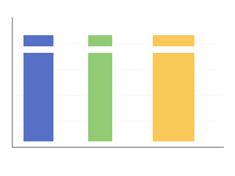

# Period Ranges Filter — Apache Superset Native Filter Plugin

Native filter plugin for **Apache Superset 6.1.0**: 1–5 arbitrary
equal-length date ranges that cross-filter every chart in scope with
correct **OR** semantics, and drive the
[Period Comparison chart](https://github.com/Kami-sama322/superset-plugin-chart-period-comparison).



## What it does

- **Independent dashboard entity** — added via *Edit → + Add filter →
  Period ranges filter*, rendered in the filter bar; not tied to any chart.
- **Multi-range OR filtering** — tables and any other chart in scope are
  filtered by `range1 OR range2 OR …`. Superset's native `TEMPORAL_RANGE`
  clauses are AND-combined, so the filter emits a single tagged adhoc SQL
  clause: `/* period_ranges:v1 */ (col >= 'S1' AND col < 'E1') OR (…)`.
  The clause stays sargable (index range scans / BitmapOr) and
  overlapping or adjacent ranges are merged into a minimal disjoint set
  before emission, so the predicate never grows with redundant branches.
- **Equal-length validation** — all ranges must have the same duration
  (blocking, inline error); overlaps warn; at least one picker stays.
- **Structured channel for the Period Comparison chart** — the ranges are
  additionally emitted in `extra_form_data.custom_form_data`; the
  comparison chart picks them up (its pickers are replaced by a
  "Periods from filter" plaque when the filter is in scope).
- **Scope** — standard native-filter scoping UI (all charts or a subset).

## Requirements

- Apache Superset **6.1.0**, Node.js 22.
- For the comparison-chart integration install
  `superset-plugin-chart-period-comparison` alongside (both sides of the
  contract ship together).

## Install

```bash
./install.sh /path/to/superset
cd /path/to/superset/superset-frontend
npm install
npm run dev-server
```

`install.sh` (idempotent): copies the package to
`plugins/plugin-filter-period-ranges/`, registers key `period_ranges` in
`setupPluginsExtra.ts`, adds the tsconfig path alias and
`FILTER_SUPPORTED_TYPES.period_ranges = [Temporal]`.

Verify: **Dashboard → Edit → + Add filter → Period ranges filter**;
pick a dataset and a temporal column in the filter configuration.

## Wire contract (for plugin authors)

`setDataMask` payload:

```ts
extraFormData: {
  filters: [],                       // never used — simple clauses AND
  adhoc_filters: [{                  // tagged OR clause, one per filter
    clause: 'WHERE', expressionType: 'SQL',
    sqlExpression: "/* period_ranges:v1 */ (col >= 'S' AND col < 'E') OR …",
  }],
  custom_form_data: [                // structured ranges (comparison chart)
    { col, start, end }, …           // ISO 8601 UTC, inclusive bounds
  ],
},
filterState: { value: '2026-01-05 00:00:00 : 2026-02-07 00:00:00' },
```

Empty state clears the filter (`NO_TIME_RANGE` semantics).

## Tests

Standalone (no Jest/npm install needed, Node ≥ 22.6):

```bash
node --experimental-strip-types scripts/run-tests.mjs
```

Inside the Superset frontend tree the same tests run under Jest.
Covered: mask building (tagged clause, custom_form_data, clear states).

## License

Apache-2.0
