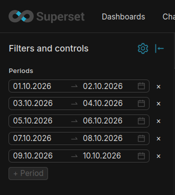

# Period Ranges Filter Plugin — Apache Superset native filter
---

### [🇷🇺 Русский](README.ru.md) | 🇬🇧 English

---

> **A custom Apache Superset plugin**: a Native Filter with **1–5 arbitrary
> date ranges** of equal length that cross-filters every chart in scope with
> correct **OR** semantics and drives the
> [Period Comparison chart](https://github.com/Kami-sama322/superset-plugin-chart-period-comparison).

---

## Features

- Dashboard Native Filter (not a chart)
- Independent dashboard entity: added via *Edit → + Add filter → Period ranges filter*, rendered in the filter bar; not tied to any chart
- Multi-range OR filtering: tables and any other chart in scope are filtered by `range1 OR range2 OR …`. Superset's native `TEMPORAL_RANGE` clauses are AND-combined, so the filter emits a single tagged adhoc SQL clause: `/* period_ranges:v1 */ (col >= 'S1' AND col < 'E1') OR (…)`
- Sargable clause: the predicate stays index-friendly (range scans / BitmapOr); overlapping and adjacent ranges are merged into a minimal disjoint set before emission, so the OR branches never grow with redundant conditions
- Equal-length validation: all ranges must have the same duration (blocking, inline error); overlaps warn
- "Filter value is required" checkbox: blocks applying the filter until at least one range is selected; without it the pickers can be removed down to zero — an empty set simply does not filter
- Structured channel for the Period Comparison chart: the ranges are additionally emitted in `extra_form_data.custom_form_data` and the chart's pickers are replaced by a plaque when the filter is in scope; a presence-only marker is emitted even while no ranges are selected — "Clear all" never brings the chart's pickers back while the filter exists
- Scope — standard native-filter scoping UI (all charts or a subset)
- Ships a Jinja addon (`jinja_addon/`) that labels dataset rows with the selected periods — standard Table / Pivot Table charts can aggregate per period (see [Jinja addon for virtual datasets](#jinja-addon-for-virtual-datasets))

---




## Requirements

| Component | Version |
|-----------|---------|
| Apache Superset | 6.1.0 |
| Python | 3.10+ |
| Node.js | 20+ (image build: 22) |
| npm | 10+ |
| React (peer) | ^17.0.2 |
| npm package | `@superset-ui/plugin-filter-period-ranges` |
| Plugin key | `period_ranges` |
| Dependencies | `dayjs` |
| Companion (optional) | [`superset-plugin-chart-period-comparison`](https://github.com/Kami-sama322/superset-plugin-chart-period-comparison) |

---

## Installation

### Step 1. Clone the Superset repository (target version)

```bash
git clone https://github.com/apache/superset.git -b 6.1.0;
```

### Step 2. Clone the plugin repository

```bash
git clone https://github.com/Kami-sama322/superset-plugin-filter-period-ranges.git;
```

### Step 3. Run the auto-installation script

```bash
chmod +x superset-plugin-filter-period-ranges/install.sh;
./superset-plugin-filter-period-ranges/install.sh ./superset;
```

> `./superset` — root of the Superset repo from Step 1. The script installs the plugin as a **standalone npm package** into `superset-frontend/plugins/plugin-filter-period-ranges/` and registers it at Superset's documented extension points. The script is idempotent (grep anchors).

#### What the script does:

| Action | File |
|--------|------|
| 0. Installs the plugin package | `superset-frontend/plugins/plugin-filter-period-ranges/` |
| 1. Registers the plugin | `superset-frontend/src/setup/setupPluginsExtra.ts` (`key: period_ranges`) |
| 2. Adds a path alias | `superset-frontend/tsconfig.json` |
| 3. Registers the filter type | `FILTER_SUPPORTED_TYPES` → `period_ranges: [GenericDataType.Temporal]` |

> Unlike chart plugins, a Native Filter **requires** its own path alias in `tsconfig.json` and an entry in `FILTER_SUPPORTED_TYPES` (`FiltersConfigForm/constants.ts`) — without it the filter is absent from the "Add filter" list.

---

### Step 4b. Manual plugin registration (if install.sh fails)

#### 1. Copy the package into the plugins folder

```bash
mkdir -p superset-frontend/plugins/plugin-filter-period-ranges/src
cp -r superset-plugin-filter-period-ranges/src/. superset-frontend/plugins/plugin-filter-period-ranges/src/
cp superset-plugin-filter-period-ranges/package.json superset-frontend/plugins/plugin-filter-period-ranges/package.json
cp superset-plugin-filter-period-ranges/tsconfig.json superset-frontend/plugins/plugin-filter-period-ranges/tsconfig.json
```

#### 2. Register in `superset-frontend/src/setup/setupPluginsExtra.ts`

```typescript
import PeriodRangesFilterPlugin from '@superset-ui/plugin-filter-period-ranges';

export default function setupPluginsExtra() {
  new PeriodRangesFilterPlugin()
    .configure({ key: 'period_ranges' })
    .register();
}
```

> Additionally add the `@superset-ui/plugin-filter-period-ranges` path alias to `superset-frontend/tsconfig.json` and `period_ranges: [GenericDataType.Temporal]` to `FILTER_SUPPORTED_TYPES` (`src/dashboard/components/nativeFilters/FiltersConfigModal/FiltersConfigForm/constants.ts`).

Then run `npm install` and `npm run dev-server`.

---

## Deploy Superset in DEV mode

### Step 5. Python environment

```bash
cd superset
python -m venv .venv
source .venv/bin/activate
pip install -r requirements/development.txt
```

### Step 6. Configuration

Copy or symlink `superset_config.py` from this repo into the Superset root, or set:

```bash
export SUPERSET_CONFIG_PATH=/path/to/superset-plugin-filter-period-ranges/superset_config.py
```

The plugin loads no external resources — no CSP exceptions are required.
The `superset_config.py` shipped in the repo is only a convenient dev setup
(DEBUG, `DASHBOARD_NATIVE_FILTERS` / `DASHBOARD_CROSS_FILTERING` flags) and
already wires the bundled Jinja addon `jinja_addon/` — see
[Jinja addon for virtual datasets](#jinja-addon-for-virtual-datasets).

### Step 7–10. Database and admin

```bash
superset db upgrade
superset fab create-admin \
  --username admin --firstname Admin --lastname User \
  --email admin@example.com --password admin
superset init
```

### Step 11–13. Backend and frontend

```bash
# terminal 1 — backend
superset run -h 0.0.0.0 -p 8088 --with-threads --reload --debugger

# terminal 2 — frontend (after install.sh + npm install in superset-frontend)
cd superset-frontend
npm install
npm run dev-server
```

---

## Quick start with Docker

This repo ships a self-contained stack: `Dockerfile` builds Superset **6.1.0**
with the plugin baked in; `docker-compose.yml` runs it with `superset_config.py`
(dev config) mounted read-only.

**Requirements:** Docker, Docker Compose v2, ~8 GB RAM for the frontend build.

```bash
git clone https://github.com/Kami-sama322/superset-plugin-filter-period-ranges.git
cd superset-plugin-filter-period-ranges

docker compose build    # first run: clones Superset 6.1.0 + npm run build (15–40 min)
docker compose up -d    # init DB, admin admin/admin, load-examples on first start
```

Open **http://localhost:8088** → login **admin** / **admin**.

On first start the container runs `superset db upgrade`, creates the admin user,
and loads example datasets (1–3 minutes). Later starts skip init if the volume
exists.

**Reset environment** (fresh DB and examples):

```bash
docker compose down -v
docker compose up -d
```

**Verify the filter:** Dashboard → Edit → + Add filter → **Period ranges filter**;
pick a dataset and a temporal column in the filter configuration.

---

## How to use the filter

1. **Dashboard → Edit dashboard → + Add filter → Period ranges filter**
2. In the filter configuration pick a dataset and a **Date column** (temporal column) — the ranges are applied to it on every chart in scope
3. On the filter bar add **1–5 date ranges** of equal length (date-only picking; the last day is inclusive). Unequal lengths block applying with an inline error; overlaps produce a warning
4. Optionally enable **Filter value is required** — then the filter cannot be applied until at least one range is selected
5. Configure the filter **scope** (all charts or a subset) and apply the configuration
6. To drive the [Period Comparison chart](https://github.com/Kami-sama322/superset-plugin-chart-period-comparison), add it to the dashboard and include it in the filter scope — it defers to the filter automatically

### Wire contract (for plugin authors)

`setDataMask` payload:

```ts
extraFormData: {
  filters: [],                       // never used — simple clauses AND
  adhoc_filters: [{                  // tagged OR clause
    clause: 'WHERE', expressionType: 'SQL',
    sqlExpression: "/* period_ranges:v1 */ (col >= 'S' AND col < 'E') OR …",
  }],
  custom_form_data: [                // structured ranges (comparison chart)
    { col, start, end }, …           // ISO 8601 UTC, inclusive bounds
  ],
},
filterState: { value: '2026-01-05 00:00:00 : 2026-02-07 00:00:00' },
```

- `adhoc_filters` — an APPEND key (`buildQueryObject` concatenates): the OR-semantics clause reaches any chart without conflicting with the core's AND-combined `TEMPORAL_RANGE` clauses
- `custom_form_data` — an APPEND key that reaches the `QueryObject` and `rawFormData.extra_form_data.custom_form_data` of the comparison chart
- An empty/invalid state clears the filter (`NO_TIME_RANGE` semantics) while `custom_form_data` carries a **presence marker** `[{col}]` — a comparison chart in scope hides its pickers immediately
- The column (`groupby`) lands in the SQL string as-is after the `isSafeSqlColumn` check; an unsafe name degrades the mask to the presence marker and the UI shows a warning

---

## Jinja addon for virtual datasets

Standard Table / Pivot Table charts cannot produce "one row per period":
the filter reaches them only as a WHERE clause, which restricts rows but
does not label them. This repo ships a Jinja addon — `jinja_addon/` — that
reads the filter's structured channel (`custom_form_data`) on the backend
and returns a CASE expression labeling every row with the period covering
it, so a Table chart with dimension = `period` aggregates rows **per
period** and any metrics as columns.

**Requires** the `ENABLE_TEMPLATE_PROCESSING` feature flag.

### Install

1. Copy `jinja_addon/` next to your `superset_config.py` (Docker stand:
   mount it to `/app/pythonpath/jinja_addon`).
2. In `superset_config.py`:

```python
import os
import sys

sys.path.insert(0, os.path.dirname(os.path.abspath(__file__)))
from jinja_addon.period_ranges import JINJA_CONTEXT_ADDONS as PERIOD_RANGES_ADDONS

FEATURE_FLAGS = {
    # ...
    "ENABLE_TEMPLATE_PROCESSING": True,
}
JINJA_CONTEXT_ADDONS = {**PERIOD_RANGES_ADDONS}
```

The repo's own `superset_config.py` is already wired this way, and the
Docker stand mounts `jinja_addon/` automatically.

### Macros

| Macro | Returns |
|-------|---------|
| `period_ranges('ts')` | `CASE WHEN ts >= 'S' AND ts < 'E' THEN 'S – E' … ELSE NULL END` — the period label per row; empty filter → `NULL` |
| `period_ranges_where('ts')` | `(ts >= 'S' AND ts < 'E') OR …` — the WHERE fragment for pushing the filter into a subquery (window functions); empty filter → `''` |

The argument must equal **the column chosen in the filter configuration**
(matched against `custom_form_data.col`). Bounds replicate the filter's
`snapEndExclusiveMs(end, "day")`, so the CASE always agrees with the tagged
OR clause; `mergeRanges` guarantees each row matches exactly one branch.
Any period length the filter allows works (day and up — the pickers are
date-only).

### Virtual dataset example

```sql

WITH FOR_FILTERS AS (
    Select *
        , {{ period_ranges('ts') }} AS period
    from main.messages
    where 1=1
    
      AND ({{ period_ranges_where('ts') }})
    
)

SELECT *
FROM FOR_FILTERS
```

- Table chart: dimension = `period`, metrics = `count(*)`, `sum(...)`, `max(...)`.
- The `cache_key_wrapper` line is **required**: the validator's cache-key
  pass only recognizes built-in macro names — without it different filter
  selections share one cached result.
- Empty filter → every label is `NULL` → one "N/A" row with totals over the
  whole table (the filter is not applied); with **Filter value is required**
  this state is blocked.

---

## Package layout

```
superset-plugin-filter-period-ranges/
├── README.md
├── README.ru.md
├── src/
│   ├── index.ts                       # ChartPlugin, key period_ranges
│   ├── PeriodRangesFilterPlugin.tsx   # pickers + setDataMask
│   ├── mask.ts                        # tagged OR clause + custom_form_data
│   ├── buildQuery.ts                  # column MIN/MAX
│   ├── transformProps.ts
│   ├── types.ts / common.ts / controlPanel.ts
│   ├── images/thumbnail.png
│   └── *.test.ts
├── jinja_addon/                      # Jinja addon for virtual datasets
│   ├── __init__.py
│   └── period_ranges.py              # period_ranges / period_ranges_where macros
├── scripts/                        # standalone test runner (node strip-types)
├── package.json
├── install.sh
├── Dockerfile                      # Superset 6.1.0 + plugin production build
├── docker-compose.yml              # Local demo stack
└── superset_config.py              # Dev/Docker config
```

---

## License

Apache License 2.0 (same as Superset)
